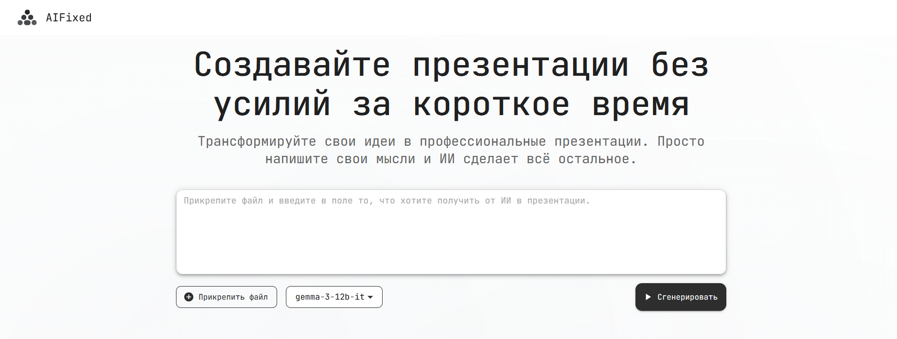
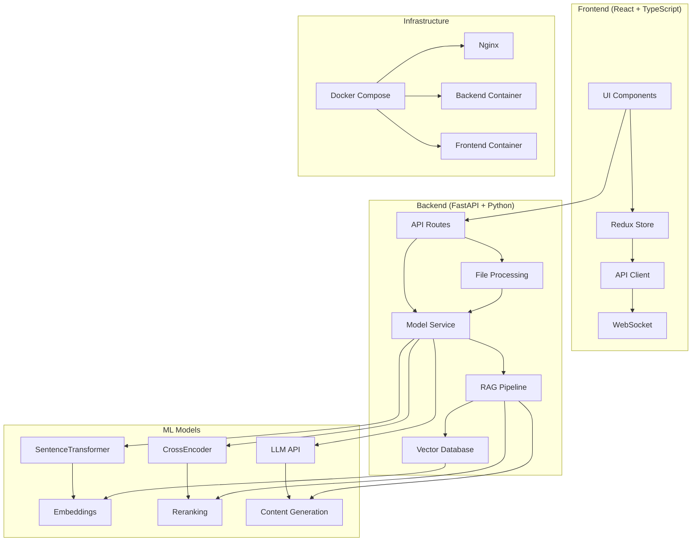

<div align="center">


**Интеллектуальная система генерации презентаций на основе ИИ с RAG-архитектурой**

[📖 Документация](#-документация) • [🚀 Быстрый старт](#-быстрый-старт) • [🏗️ Архитектура](#️-архитектура) • [🤖 ML Модели](#-ml-модели) • [📊 API](#-api)

</div>

---

## 📋 Оглавление

- [🎯 Описание проекта](#-описание-проекта)
- [✨ Основные возможности](#-основные-возможности)
- [🏗️ Архитектура](#️-архитектура)
- [🤖 ML Модели](#-ml-модели)
- [🚀 Быстрый старт](#-быстрый-старт)
- [📦 Установка зависимостей](#-установка-зависимостей)
- [⚙️ Конфигурация](#️-конфигурация)
- [🔧 Разработка](#-разработка)
- [🐳 Docker](#-docker)
- [📊 API](#-api)
- [🎨 Frontend](#-frontend)
- [🔧 Backend](#-backend)
- [📁 Структура проекта](#-структура-проекта)
- [🤝 Вклад в проект](#-вклад-в-проект)
- [📄 Лицензия](#-лицензия)

---

## 🎯 Описание проекта

**AIFixed** — это полнофункциональная система для автоматической генерации презентаций с использованием искусственного интеллекта. Проект объединяет современные технологии машинного обучения, веб-разработки и обработки документов для создания интеллектуального инструмента создания презентаций.

### 🎨 Ключевые особенности

- **🧠 ИИ-генерация контента** - Автоматическое создание слайдов на основе загруженных документов
- **📄 RAG-архитектура** - Retrieval-Augmented Generation для точной работы с контекстом
- **🎭 Адаптивные темы** - Различные визуальные темы для разных типов аудитории
- **✏️ Интерактивное редактирование** - Возможность редактирования слайдов в реальном времени
- **📊 Автоматическая визуализация** - Генерация диаграмм и графиков на основе данных
- **🌐 Современный UI** - React + Material-UI интерфейс с анимациями

---

## ✨ Основные возможности

### 🎯 Генерация презентаций
- **Классификация аудитории** - Автоматическое определение типа аудитории (TopManagement, Experts, Investors)
- **Планирование структуры** - ИИ создает оптимальную структуру презентации
- **Контекстная генерация** - Использование загруженных документов для создания релевантного контента

### 📝 Редактирование слайдов
- **Множественные действия** - Polish, Correct, Translate, Expand, Shorten, Simplify, Specify
- **Пользовательские промпты** - Возможность задать собственные инструкции
- **Визуальное редактирование** - Drag & Drop интерфейс для перестановки блоков

### 📊 Визуализация данных
- **Автоматические диаграммы** - Генерация bar, line, pie charts на основе данных
- **Интерактивные графики** - Использование Chart.js для создания интерактивных элементов
- **Адаптивные темы** - Различные цветовые схемы и стили

---

## 🎥 Предпросмотр сервиса



---

## 🏗️ Архитектура



### 🔄 Поток данных

1. **Загрузка документа** → Обработка файла → Извлечение текста
2. **Создание эмбеддингов** → Векторизация → Сохранение в Qdrant
3. **Пользовательский запрос** → Классификация аудитории → Планирование структуры
4. **Генерация контента** → RAG поиск → LLM генерация → Создание слайдов
5. **Редактирование** → Пользовательские действия → Регенерация контента

---

## 🤖 ML Модели

### 📊 Используемые модели

| Модель | Назначение | Размер | Производительность |
|--------|------------|--------|-------------------|
| **BAAI/bge-m3** | Embeddings для RAG | ~1.2GB | 1024 dim |
| **cross-encoder/ms-marco-MiniLM-L-6-v2** | Reranking результатов | ~80MB | Fast inference |
| **OpenRouter API** | LLM для генерации | Cloud | Various models |

### 🔧 Конфигурация моделей

```python
# Настройки по умолчанию
DEFAULT_EMBEDDING_MODEL = "BAAI/bge-m3"
CROSS_ENCODER_MODEL = "cross-encoder/ms-marco-MiniLM-L-6-v2"
DEFAULT_MODEL = "moonshotai/kimi-k2-0905"  # OpenRouter
```

### 🚀 Поддерживаемые LLM модели

- `moonshotai/kimi-k2-0905` - Основная модель
- `openai/gpt-oss-120b` - Альтернативная
- `google/gemma-3-12b-it` - Google Gemma

---

## 🚀 Быстрый старт

### 📋 Предварительные требования

- **Docker** и **Docker Compose**
- **Node.js** 18+ (для разработки)
- **Python** 3.11+ (для разработки)
- **Git**

### ⚡ Запуск через Docker

```bash
# Клонирование репозитория
git clone https://github.com/aklyue/AIFixed.git
cd AIFixed

# Создание .env файлов
cp backend/.env.example backend/.env
cp frontend/.env.example frontend/.env

# Запуск всех сервисов
docker-compose up --build
```

### 🌐 Доступ к приложению

- **Frontend**: http://localhost:3000
- **Backend API**: http://localhost:8000
- **API Documentation**: http://localhost:8000/docs

---

## 🗺 Роутинг

| Путь | Компонент / Описание |
|---|---|
| `/` | `PromptPage` — главная страница и отправка промпта (требуется авторизация) |
| `/generate` | `GeneratePage` — генерация презентации (требуется авторизация) |
| `/editor` | `EditorPage` — редактор презентации (требуется авторизация) |
| `/projects` | `MyPresentationsPage` — список презентаций (требуется авторизация) |
| `/settings` | `SettingsPage` — настройки пользователя (требуется авторизация) |
| `/auth` | `AuthPage` — авторизация |
| `/verify-email` | `VerificationPage` — подтверждение почты |
| `/auth/success` | `OAuthSuccess` — завершение OAuth-аутентификации |

Маршруты и их композиция находятся в `frontend/src/app/config/routes.tsx`; защищённые страницы проходят через `ProtectedRoute`.

## 📦 Установка зависимостей

### 🐍 Backend (Python)

```bash
cd backend

# Создание виртуального окружения
python -m venv venv
source venv/bin/activate  # Linux/Mac
# или
venv\Scripts\activate     # Windows

# Установка зависимостей
pip install -r requirements.txt
```

### ⚛️ Frontend (Node.js)

```bash
cd frontend

# Установка зависимостей
npm install

# Запуск в режиме разработки
npm start
```

---

## ⚙️ Конфигурация

### 🔑 Переменные окружения

#### Backend (.env)
```env
# API Keys
OPENROUTER_API_KEY=your_openrouter_key
OPENAI_API_KEY=your_openai_key  # опционально

# Model Configuration
DEFAULT_MODEL=moonshotai/kimi-k2-0905
DEFAULT_EMBEDDING_MODEL=BAAI/bge-m3
CROSS_ENCODER_MODEL=cross-encoder/ms-marco-MiniLM-L-6-v2

# File Processing
TEMPFILE_DIR=./tempfiles
TEMPFILE_CLEANUP_INTERVAL_SECONDS=3600

# Environment
ENVIRONMENT=production

# PostgreSQL
POSTGRES_USER=postgres
POSTGRES_PASSWORD=password
POSTGRES_DB=yourdb
POSTGRES_HOST=localhost
POSTGRES_PORT=5432

# JWT
SECRET_KEY=your_secret_key
ALGORITHM=HS256

# SMTP
SMTP_HOST=smtp.gmail.com
SMTP_PORT=587
SMTP_USER=your_email@gmail.com
SMTP_PASSWORD=smtp_password
SMTP_FROM_EMAIL=your_email@gmail.com

# GitHub OAuth
GITHUB_CLIENT_ID=github_client_id
GITHUB_CLIENT_SECRET=github_client_secret_key
GITHUB_REDIRECT_URI=http://localhost:8000/auth/github/callback

# Google OAuth
GOOGLE_CLIENT_ID=google_client_id
GOOGLE_CLIENT_SECRET=google_client_secret_key
GOOGLE_REDIRECT_URI=http://localhost:8000/auth/google/callback
FRONT_URL=http://localhost:3000

```

#### Frontend (.env)
```env
REACT_APP_API_URL=http://localhost:8000/api
REACT_APP_WS_URL=ws://localhost:8000/ws
```

### 🎛️ Настройки модели

```python
# backend/src/config.py
class ModelSettings:
    MIN_SLIDES = 10
    MAX_SLIDES = 15
    TOP_K_RETRIEVAL = 5
    CHUNK_SIZE = 512
    CHUNK_OVERLAP = 50
    GEN_TEMPERATURE = 0.2
```

---

## 🔧 Разработка

### 🚀 Локальная разработка

#### Backend
```bash
cd backend
python -m src.preload  # Предзагрузка моделей
uvicorn src.main:app --reload --host 0.0.0.0 --port 8000
```

#### Frontend
```bash
cd frontend
npm start
```

### 📊 Мониторинг

- **Логи**: Структурированные логи с уровнем INFO
- **Метрики**: Время генерации, использование памяти
- **Health Check**: `/api/health` endpoint

---

## 🐳 Docker

### 🏗️ Сборка образов

```bash
# Backend
docker build -t ai-presentation-backend ./backend

# Frontend
docker build -t ai-presentation-frontend ./frontend
```

### 🚀 Docker Compose

```yaml
version: '3.8'
services:
  nginx:
    image: nginx:alpine
    ports: ["80:80", "443:443"]
    depends_on: [backend, frontend]
  
  frontend:
    build: ./frontend
    environment:
      - NODE_ENV=production
  
  backend:
    build: ./backend
    environment:
      - ENVIRONMENT=production
    volumes:
      - models_cache:/models_cache
```

### 📁 Volumes

- `models_cache` - Кэш для ML моделей
- `tempfiles` - Временные файлы
- `certbot` - SSL сертификаты

---

## 📊 API

### 🎯 Основные эндпоинты

#### Генерация презентации
```http
POST /api/presentation/generate
Content-Type: multipart/form-data

text: "Описание презентации"
file: [uploaded file]
model: "moonshotai/kimi-k2-0905"
```

#### Редактирование слайда
```http
POST /api/presentation/edit
Content-Type: application/json

{
  "text": "Новый текст слайда",
  "slide": {...},
  "action": "polish",
  "model": "moonshotai/kimi-k2-0905"
}
```

#### Получение файла
```http
GET /api/files/{filename}
```

#### Авторизация пользователя
```http
POST /api/auth/register

POST /api/auth/login

GET /api/auth/me
```

#### Верификация
```http
POST /api/auth/email/send_code

POST /api/auth/email/verify
```

#### OAuth 2.0
```https
GET /api/auth/github/login
GET /api/auth/github/callback

GET /api/auth/google/login
GET /api/auth/google/callback
```

#### Настройки пользователя
```http
PUT /api/user/edit
```

#### Подробное описание маршрутов
```http
http://localhost:8000/docs
```

### 📋 Схемы данных

#### GeneratePresInSchema
```python
{
  "text": str,      # Описание презентации
  "model": str      # Модель LLM
}
```

#### EditSlideInSchema
```python
{
  "text": str,      # Новый текст
  "slide": dict,    # Данные слайда
  "action": str,    # Действие (polish, correct, etc.)
  "model": str      # Модель LLM
}
```

---

## 🎨 Frontend

### 🏗️ Архитектура (Feature-Sliced Design)

```
frontend/src/
├── app/                                      # Инициализация и конфигурация приложения
│   ├── config/
│   │   ├── routes.tsx                        # Конфигурация маршрутов
│   │   └── theme.ts                          # Конфигурация темы
│   ├── providers/
│   │   ├── ErrorBoundary/
│   │   ├── LayoutProvider/
│   │   ├── ReduxProvider/
│   │   ├── RouterProvider/
│   │   │   └── ProtectedRoute/
│   │   └── ThemeProvider/
│   ├── store/
│   │   ├── middleware/
│   │   └── index.ts                          # Сборка Redux store
│   ├── styles/
│   ├── types/
│   └── App.tsx
│
├── entities/                                 # Доменные данные, API и модели состояния
│   ├── auth/
│   │   ├── api/
│   │   └── model/
│   │       └── slices/
│   │           └── authSlice.ts
│   ├── github/
│   │   └── api/
│   ├── markdown/
│   │   └── model/
│   │       └── slices/
│   │           └── markdownSlice.ts
│   ├── presentation/
│   │   ├── api/
│   │   └── model/
│   │       └── slices/
│   │           ├── editorSlice.ts
│   │           └── uiSlice.ts
│   ├── prompt/
│   │   └── model/
│   │       └── slices/
│   │           └── promptSlice.ts
│   └── user/
│       └── api/
│
├── features/                                 # Пользовательские сценарии и действия
│   ├── auth/
│   │   ├── authAuthorization/
│   │   │   ├── lib/
│   │   │   │   └── hooks/
│   │   │   └── ui/
│   │   │       ├── Authorization/
│   │   │       ├── LoginBlock/
│   │   │       └── RegistrationBlock/
│   │   ├── authCheck/
│   │   │   └── lib/hooks/
│   │   └── authVerifyEmail/
│   │       ├── lib/hooks/
│   │       └── ui/VerificationBlock/
│   │
│   ├── presentation/
│   │   ├── editPresentation/
│   │   │   ├── lib/
│   │   │   │   ├── constants/
│   │   │   │   ├── hooks/
│   │   │   │   └── utils/
│   │   │   └── ui/
│   │   │       ├── AddSlideDialog/
│   │   │       ├── EditSlideDialog/
│   │   │       ├── EmptyState/
│   │   │       ├── SlideNavigationToolbar/
│   │   │       ├── SlideToolbar/
│   │   │       └── ThemeSelector/
│   │   ├── generatePresentation/
│   │   │   ├── lib/hooks/
│   │   │   └── ui/
│   │   │       ├── AiChat/
│   │   │       ├── BlockGeneration/
│   │   │       ├── PromptSend/
│   │   │       ├── RenderBlock/
│   │   │       ├── SlidesList/
│   │   │       ├── SortableSlide/
│   │   │       └── ThemeCardSelector/
│   │   ├── managePresentations/
│   │   │   ├── lib/hooks/
│   │   │   └── ui/MyPresentations/
│   │   ├── renderBlock/
│   │   │   ├── lib/
│   │   │   │   ├── hooks/
│   │   │   │   └── utils/
│   │   │   └── ui/RenderBlock/
│   │   │       ├── ChartBlock/
│   │   │       ├── ChartBlockWrapper/
│   │   │       ├── ChartEditor/
│   │   │       ├── CodeBlock/
│   │   │       ├── EditableWrapper/
│   │   │       ├── HeadingBlock/
│   │   │       ├── ListBlock/
│   │   │       ├── ParagraphBlock/
│   │   │       ├── QuoteBlock/
│   │   │       ├── TableBlockWrapper/
│   │   │       ├── TableEditor/
│   │   │       ├── TextEditor/
│   │   │       └── Toolbar/
│   │   ├── savePresentation/
│   │   │   └── lib/hooks/
│   │   └── slideContent/
│   │       ├── lib/
│   │       │   ├── hooks/
│   │       │   └── types/
│   │       └── ui/
│   │           ├── Grid2x2Layout/
│   │           ├── GridTextTopTwoBottomLayout/
│   │           ├── ImageColumnLayout/
│   │           ├── ImageRowLayout/
│   │           ├── ResizableImage/
│   │           └── SortableBlock/
│   │
│   └── user/
│       └── updateSettings/
│           ├── lib/hooks/
│           └── ui/SettingsForm/
│
├── pages/                                    # Страницы, подключаемые маршрутизатором
│   ├── AuthPage/
│   ├── EditorPage/
│   ├── GeneratePage/
│   ├── MyPresentationsPage/
│   ├── PromptPage/
│   ├── SettingsPage/
│   ├── VerificationPage/
│   └── index.ts
│
├── shared/                                   # Общие UI, типы и утилиты
│   ├── assets/
│   │   ├── images/
│   │   └── logo/
│   ├── config/
│   ├── hooks/
│   ├── lib/utils/
│   ├── types/
│   └── ui/
│       ├── LoadingOverlay/
│       └── OAuthSuccess/
│
└── widgets/                                  # Композиционные блоки интерфейса
    ├── landing/
    │   ├── FeaturesBlock/
    │   ├── HowItWorksBlock/
    │   ├── QuickStartBlock/
    │   ├── StartBlock/
    │   └── WhyUsBlock/
    ├── layout/
    │   ├── Footer/
    │   │   ├── lib/hooks/
    │   │   └── ui/
    │   └── Header/
    │       ├── lib/hooks/
    │       └── ui/
    └── presentation/
        └── PresentationEditor/
            └── ui/
                ├── MarkdownPresentation/
                ├── MiniSlides/
                ├── RenderBlock/
                ├── SlideContent/
                ├── SlideEditPrompt/
                ├── SlideItem/
                └── SlideList/
```

Redux slices хранятся в `entities/<entity>/model/slices`; `app/store` собирает reducers, а `app/providers` подключает store и остальные обёртки приложения. Фичи и виджеты разделены на самостоятельные slices с `ui` и `lib`. Публичный `index.ts` находится на уровне slice и экспортирует API непосредственно из файлов реализации; рядом с отдельными компонентами barrel-файлы не используются. Страницы композируют фичи и виджеты и не обращаются к Redux напрямую.

### 🎨 Технологии

- **React 19.2.0** - Основной фреймворк
- **TypeScript** - Типизация
- **Dnd-Kit** - Перетаскивание слайдов/блоков
- **Material-UI** - UI компоненты
- **Redux Toolkit** - Управление состоянием
- **Framer Motion** - Анимации
- **Chart.js** - Графики и диаграммы
- **React Router** - Маршрутизация

### 🎭 Темы и стилизация

```typescript
interface Theme {
  id: string;
  name: string;
  colors: {
    background: string;
    heading: string;
    paragraph: string;
    backgroundImages?: string[];
  };
  fonts: {
    heading: string;
    paragraph: string;
  };
}
```

---

## 🔧 Backend

### 🏗️ Архитектура

```
src/
├── main.py              # FastAPI приложение
├── config.py            # Конфигурация
├── preload.py           # Предзагрузка моделей
├── modules/             # Основные модули
│   └── models/          # ML модели и RAG
├── routes/              # API маршруты
├── services/            # Бизнес-логика
├── schemas/             # Pydantic схемы
└── utils/               # Утилиты
```

### 🔄 RAG Pipeline

1. **Document Processing** - Обработка загруженных файлов
2. **Chunking** - Разбиение на фрагменты (512 токенов)
3. **Embedding** - Создание векторных представлений
4. **Storage** - Сохранение в Qdrant
5. **Retrieval** - Поиск релевантных фрагментов
6. **Reranking** - Переранжирование с CrossEncoder
7. **Generation** - Создание контента с LLM

### 📊 Обработка файлов

Поддерживаемые форматы:
- **PDF** - pdfplumber, PyMuPDF
- **DOCX** - python-docx
- **PPTX** - python-pptx
- **TXT** - Прямая обработка
- **Markdown** - docx2md

---

## 📁 Структура проекта

```
AIFixed/
├── backend/                                    # Набор модулей нового
│   ├── go-module/                              # HTTP API и доменная логика на Go
│   │   ├── cmd/
│   │   │   └── server/
│   │   │       └── main.go
│   │   ├── configs/
│   │   │   └── .env.example
│   │   ├── internal/
│   │   │   ├── config/
│   │   │   │   └── config.go
│   │   │   ├── db/
│   │   │   │   ├── migrations.go
│   │   │   │   └── postgres.go
│   │   │   ├── handlers/
│   │   │   │   ├── auth/
│   │   │   │   │   ├── auth_handler.go
│   │   │   │   │   ├── oauth_github.go
│   │   │   │   │   └── oauth_google.go
│   │   │   │   ├── message/
│   │   │   │   │   └── message_handler.go
│   │   │   │   ├── presentation/
│   │   │   │   │   ├── ai_handler.go
│   │   │   │   │   └── presentation_handler.go
│   │   │   │   ├── tempfile/
│   │   │   │   │   └── tempfile_handler.go
│   │   │   │   └── user/
│   │   │   │       └── user_handler.go
│   │   │   ├── middleware/
│   │   │   │   └── auth_middleware.go
│   │   │   ├── models/
│   │   │   │   ├── presentation/
│   │   │   │   │   └── presentation.go
│   │   │   │   ├── tempfile/
│   │   │   │   │   └── tempfiles.go
│   │   │   │   └── user/
│   │   │   │       └── user.go
│   │   │   ├── router/
│   │   │   │   ├── app.go
│   │   │   │   ├── auth.go
│   │   │   │   └── router.go
│   │   │   └── services/
│   │   │       ├── auth/
│   │   │       │   ├── auth_service.go
│   │   │       │   ├── email_verification.go
│   │   │       │   └── jwt.go
│   │   │       ├── presentation/
│   │   │       │   └── presentation_service.go
│   │   │       └── tempfile/
│   │   │           └── tempfile_service.go
│   │   ├── migrations/
│   │   │   └── 001_create_email_verifications.sql
│   │   ├── Dockerfile
│   │   ├── go.mod
│   │   └── go.sum
│   │
│   ├── python-module/                          # AI, генерация и обработка документов
│   │   ├── adapters/
│   │   │   ├── file_storage.py
│   │   │   ├── model_manager.py
│   │   │   ├── openrouter_client.py
│   │   │   └── qdrant_repository.py
│   │   ├── api/
│   │   │   ├── dependencies.py
│   │   │   ├── middleware.py
│   │   │   └── routers/
│   │   │       ├── health.py
│   │   │       ├── message.py
│   │   │       └── presentation.py
│   │   ├── core/
│   │   │   ├── exceptions.py
│   │   │   ├── logging.py
│   │   │   └── prompts.py
│   │   ├── models/
│   │   │   ├── schemas.py
│   │   │   └── slide.py
│   │   ├── parsers/
│   │   │   ├── base.py
│   │   │   ├── docx.py
│   │   │   ├── pdf.py
│   │   │   ├── pptx.py
│   │   │   └── registry.py
│   │   ├── services/
│   │   │   ├── ai_service.py
│   │   │   ├── generation_service.py
│   │   │   ├── parsing_service.py
│   │   │   └── rag_service.py
│   │   ├── utils/
│   │   │   ├── file.py
│   │   │   ├── json.py
│   │   │   └── text.py
│   │   ├── config.py
│   │   ├── main.py
│   │   ├── Dockerfile
│   │   └── requirements.txt
│   └── .env.example
│
├── frontend/                                   # React + TypeScript frontend
│   ├── src/                                    # Feature-Sliced Design (см. раздел Frontend)
│   ├── public/
│   ├── config/
│   ├── Dockerfile
│   └── package.json
│
├── nginx/                                      # Nginx конфигурация
├── docker-compose.yml
└── README.md
```

## 🤝 Вклад в проект

### 🔧 Настройка для разработки

1. **Fork** репозитория
2. **Clone** вашей копии
3. Создайте **feature branch**
4. Внесите изменения
5. Создайте **Pull Request**

### 📝 Стандарты кода

- **Python**: PEP 8, Black formatter
- **TypeScript**: ESLint, Prettier
- **Commits**: Conventional Commits
- **Tests**: Покрытие > 80%

### 🐛 Сообщение об ошибках

Используйте GitHub Issues с шаблоном:
- Описание проблемы
- Шаги воспроизведения
- Ожидаемое поведение
- Логи и скриншоты

---

## 📄 Лицензия

Этот проект распространяется под лицензией **MIT**. См. файл [LICENSE](LICENSE) для подробностей.

---

<div align="center">

**Создано с ❤️ для автоматизации создания презентаций**

[🔗 GitHub](https://github.com/aklyue/AIFixed) • [📦 Releases](https://github.com/aklyue/AIFixed/releases) • [📧 Email](mailto:olegglapshin@gmail.com) • [🐛 Issues](https://github.com/aklyue/AIFixed/issues)

</div>
